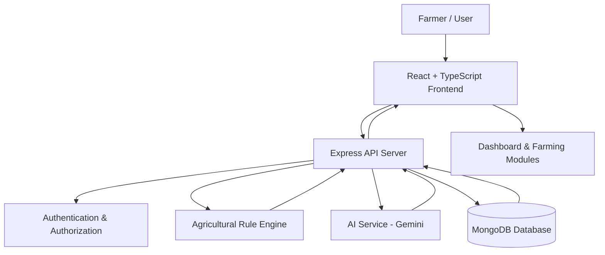

# 🌱 Krishi AgriTech
### Smart Farming • Agricultural Intelligence • AI-Assisted Advisory

**An evolving digital farming platform designed to help Indian farmers make more informed agricultural decisions through technology, data, and AI.**

<p align="center">
  <a href="https://krishi-agritech.vercel.app/">
    
  </a>
  <a href="https://github.com/KKU022/AgriTech">
    
  </a>
</p>

<p align="center">
  
  
  
  
</p>

---

## 📖 About the Project

Agriculture increasingly depends on timely information, accessible digital tools, and informed decision-making. However, farmers may face challenges in interpreting crop requirements, understanding weather conditions, identifying plant health concerns, and navigating agricultural resources.

**Krishi AgriTech** is an academic software engineering project exploring how these capabilities can be brought together in a single, farmer-oriented web application.

The platform combines a personalized farming dashboard, rule-based crop recommendations, AI-assisted agricultural guidance, plant disease screening, weather and irrigation information, and agricultural resource discovery.

Built with a modern TypeScript-based web stack, the project emphasizes modular architecture, authenticated user experiences, responsive interfaces, and responsible AI assistance.

> 🚧 **Development status:** AgriTech is actively being developed. Some modules use sample or illustrative data, and certain integrations and workflows are still being improved. Refer to the feature status and limitations below before relying on any agricultural output.

## 🚀 Live Demo

**Explore the deployed application:**  
https://krishi-agritech.vercel.app/

**Source code:**  
https://github.com/KKU022/AgriTech

The live demo is intended to showcase the application's interface, workflows, and current implementation. Feature availability may depend on deployment configuration, environment variables, and connected services.

---

## ✨ Key Features

| Module | Capabilities |
|---|---|
| 🏡 Farming Dashboard | Farmer-oriented overview, agricultural context, quick actions, and dashboard insights |
| 🌾 Crop Recommendations | Rule-based crop suitability suggestions using farming parameters such as soil, season, and irrigation |
| 🔬 Plant Disease Screening | Image upload or camera capture for AI-assisted plant health analysis |
| 🤖 Farming Assistant | Conversational agricultural guidance with English/Hindi support and farmer-specific context |
| 🌦️ Weather & Irrigation | Weather-related information, forecasts where available, and irrigation guidance |
| 📚 Resource Center | Agricultural learning resources and links to official government portals |
| 📈 Mandi Benchmarks | Commodity reference data and unit-conversion utilities for demonstration |
| 👨‍🌾 Farmer Profile | Farmer-specific details, land information, soil characteristics, and irrigation preferences |
| 🔐 Authentication | Email/password authentication and Google Sign-In integration |
| 🗂️ Conversation History | Persistent assistant conversations associated with authenticated users |

### Responsible AI and agricultural safeguards

- Rule-based crop recommendations are separated from AI-generated explanations.
- Agricultural advice can use relevant farmer profile information when available.
- The assistant includes safeguards around chemical pesticide dosage requests.
- Plant disease screening is an aid for preliminary assessment, not a substitute for professional diagnosis.
- Agricultural recommendations should be verified against trusted sources and local expert advice.

---

## 🖥️ Application Architecture

The application follows a client-server architecture. The frontend communicates with an Express backend, which handles authentication, application logic, AI requests, and database operations.



### Technology stack

| Layer | Technologies |
|---|---|
| Frontend | React 19, TypeScript, Vite |
| Styling & UI | Tailwind CSS and reusable UI components |
| Backend | Node.js, Express.js, TypeScript |
| Database | MongoDB / MongoDB Atlas |
| Authentication | JWT, bcrypt-based password handling, Google Identity Services |
| AI integration | Google Gemini API using `@google/genai` |
| Development runtime | Bun and `tsx` |
| Deployment | Vercel for the deployed web application |

*The repository's actual package manifests and environment template are the source of truth for exact versions and configuration.*

---

## 🧩 Core Design Principles

### 1. Rule-based recommendations

Crop recommendations use agricultural parameters and deterministic rules where implemented. AI can help explain the results in more accessible language.

### 2. Farmer-specific context

The backend can use authenticated farmer profile information, such as location, soil type, irrigation source, and land area, to personalize relevant features.

### 3. Server-side security

- Protected API endpoints validate authentication tokens.
- User identity is derived from verified authentication rather than trusting arbitrary client-supplied IDs.
- Database operations should enforce ownership checks.
- AI service credentials remain server-side.

### 4. Modular development

The project separates the user interface, API routes, agricultural logic, authentication, AI integration, and persistence to support incremental development and testing.

---

## 📊 Feature Readiness

AgriTech contains several implemented application modules, but their data sources and completeness differ. This table distinguishes the current direction from functionality that still needs validation.

| Feature | Current status |
|---|---|
| Authentication and user profiles | Implemented; verify in the deployed environment |
| Farming dashboard | Implemented; data freshness depends on connected sources |
| Crop recommendation workflow | Rule-based recommendation module implemented |
| Farming Assistant | Gemini integration implemented; continued improvement planned |
| Plant disease screening | AI-assisted screening workflow implemented |
| Weather and irrigation | Module implemented; verify live data sources and location coverage |
| Resource Center | Curated resources and official links; update verification as needed |
| Mandi prices | **Sample reference data — not live auction prices** |
| Ollama/local AI integration | Planned |
| Additional data integrations and workflow improvements | In progress |

*Status describes the current development direction, not a guarantee that every feature is available in every deployment.*

---

## 🛠️ Getting Started

### Prerequisites

- Git
- Bun installed on your development machine
- A supported Node.js runtime
- MongoDB Atlas or a compatible MongoDB instance
- A Gemini API key for AI features
- Google OAuth/Identity configuration if Google Sign-In is enabled

### 1. Clone the repository

```bash
git clone https://github.com/KKU022/AgriTech.git
cd AgriTech
```

### 2. Install dependencies

```bash
bun install
```

### 3. Configure environment variables

Create your local `.env` file using the repository's `.env.example` as a reference.

Typical configuration categories include:

```dotenv
PORT=3000
APP_NAME=AgriTech

# Use values from your own environment configuration.
MONGODB_URI=your_mongodb_connection_string
JWT_SECRET=your_secure_random_secret

GEMINI_API_KEY=your_gemini_api_key
GEMINI_MODEL=your_supported_gemini_model

# Configure the Google client ID if required by the current implementation.
```

**Important:** The example above is illustrative. Check `.env.example` and the current server code for the exact required variable names. Do not commit `.env`, real API keys, database credentials, or JWT secrets to GitHub.

### 4. Start the development server

```bash
bun run dev
```

Open the local application at:

http://localhost:3000

### 5. Run quality checks

```bash
bun run lint
bun run build
```

Run any additional test commands defined in the project's package scripts before submitting changes.

---

## 🔒 Security and Privacy

Security is an ongoing engineering responsibility. The project is designed around the following practices:

- Keep secrets in environment variables rather than source code.
- Validate authentication on protected backend routes.
- Enforce ownership checks for private records and conversations.
- Validate uploaded files and reject unsupported formats.
- Apply appropriate request limits and input validation.
- Avoid logging passwords, access tokens, or sensitive user information.
- Use HTTPS for production access and configure allowed origins appropriately.

Users should avoid uploading sensitive documents or personal information unless necessary. AI-generated agricultural advice can be incomplete or incorrect and must be reviewed before practical use.

---

## ⚠️ Data Limitations and Disclaimers

### Mandi prices

The Mandi Benchmarks module currently includes **sample reference data for demonstration**. These values do not represent verified live auction prices and should not be used for trading or financial decisions.

### Weather and irrigation

The availability and freshness of weather information depend on the configured data source and successful API responses. Confirm the displayed location, timestamp, and forecast source before making irrigation decisions.

### Plant disease analysis

Image-based screening is experimental decision support. It cannot guarantee a diagnosis, and users should consult a qualified agricultural specialist or Krishi Vigyan Kendra (KVK) when appropriate.

### Government schemes and resources

Government links are provided to help users locate official information. Eligibility, deadlines, benefits, and application requirements can change. Always verify them with the relevant official portal or department.

### AI-generated advice

AI outputs are informational and may contain errors. The platform is not a replacement for local agricultural expertise, laboratory diagnosis, or official advisories.

---

## 🗺️ Development Roadmap


### Planned improvements

- [ ] Integrate Ollama as an optional local AI provider while preserving Gemini support.
- [ ] Improve assistant response quality, error handling, and conversation experience.
- [ ] Improve weather location search, source transparency, and forecast freshness.
- [ ] Investigate reliable, permitted sources for current mandi price data.
- [ ] Expand agricultural resource search and verification.
- [ ] Improve farmer community moderation and consultation tracking.
- [ ] Develop marketplace inquiry and order-status workflows without requiring online payments initially.
- [ ] Expand automated tests, accessibility checks, and production monitoring.
- [ ] Improve mobile usability and performance.

Roadmap items are planned work, not promises that each integration is already operational.

---

## 🎓 Academic Context

Krishi AgriTech is a B.Tech Computer Science capstone-style project exploring the application of modern web technologies, AI-assisted interfaces, and structured agricultural decision support to farming-related problems.

The project provides an opportunity to apply software engineering principles including modular design, API development, authentication, database persistence, input validation, and iterative testing.

**Project objectives:**

- Make agricultural information more accessible through a unified web interface.
- Explore the combination of deterministic rules and AI-assisted explanations.
- Build a maintainable full-stack application with secure user-specific data.
- Develop and evaluate features incrementally using real-world constraints.

---

## 🤝 Contributing

Contributions, suggestions, bug reports, and feedback are welcome.

1. Fork the repository.
2. Create a feature branch.
3. Implement and test your changes.
4. Commit with a clear message.
5. Open a pull request describing the change and its testing status.

Please do not include credentials, private farmer data, or unverified claims about agricultural accuracy in contributions.

---

## 📜 License

A license has not yet been specified in this README. Until a license is added to the repository, do not assume that the source code is available for unrestricted reuse, modification, or redistribution.

---

## 🌱 Explore AgriTech

**Live Demo:** https://krishi-agritech.vercel.app/  
**GitHub Repository:** https://github.com/KKU022/AgriTech

*Built as an evolving exploration of AI-assisted, data-aware, and farmer-oriented digital agriculture. More improvements are in progress.*
